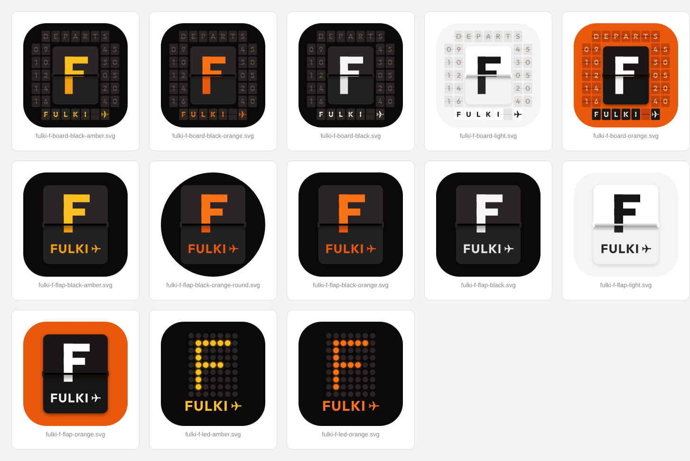

# Fulki Travel & Tours — logo set

Vector masters are the `.svg` files; `png/` holds transparent exports (lockups 2000 px wide, icons 1024 px).
Text is outlined from Outfit, the site's display font, so the files need no fonts installed.

| File | Use |
| --- | --- |
| `fulki-travel-tours-primary.svg` | Default logo on white / light backgrounds |
| `fulki-travel-tours-reversed.svg` | On dark backgrounds and photos |
| `fulki-travel-tours-on-orange.svg` | All-white on brand orange (signage, banners) |
| `fulki-travel-tours-mono-black.svg` | Single-colour print, stamps, fax, engraving |
| `fulki-travel-tours-horizontal.svg` | Website header, email signature, letterhead |
| `fulki-travel-tours-horizontal-reversed.svg` | Same, on dark |
| `fulki-icon-orange.svg` | Icon only: app icon, social avatars |
| `fulki-icon-dark.svg` / `fulki-icon-light.svg` | Icon only on dark / light surfaces |
| `fulki-icon-round.svg` | Icon only, circular crop (WhatsApp, Instagram, Facebook) |
| `fulki-icon-plane.svg` | Alternative icon: plane climbing out of its contrail |

### Departure-board F (`f-board/`)

Icon only: the F on a split-flap card, as on an airport departures board, with the split running just under
the middle arm and a small FULKI + plane underneath.

- `fulki-f-flap-*`: the single flap card. Themes: `black`, `black-orange`, `black-amber`, `orange`, `light`;
  plus `black-orange-round` for circular avatars.
- `fulki-f-board-*`: the same card set into a departures board (DEPARTS / times), with FULKI + plane spelled out on the bottom row of flaps. Best at 128 px and up;
  use the flap version for small sizes.
- `fulki-f-led-*`: dot-matrix F, as on LED departure displays (`amber`, `orange`).

Colours: orange `#EA580C`, ink `#171717`, night `#0C0A09`.
Keep clear space around the logo at least the height of the plane, and don't use the
full lockup below 120 px wide; switch to an icon instead.

Regenerate with `python3 tools/build_logos.py` (needs `pip install fonttools brotli uharfbuzz`).
