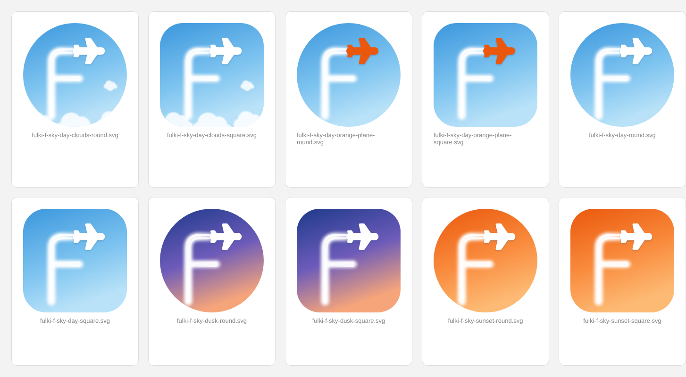
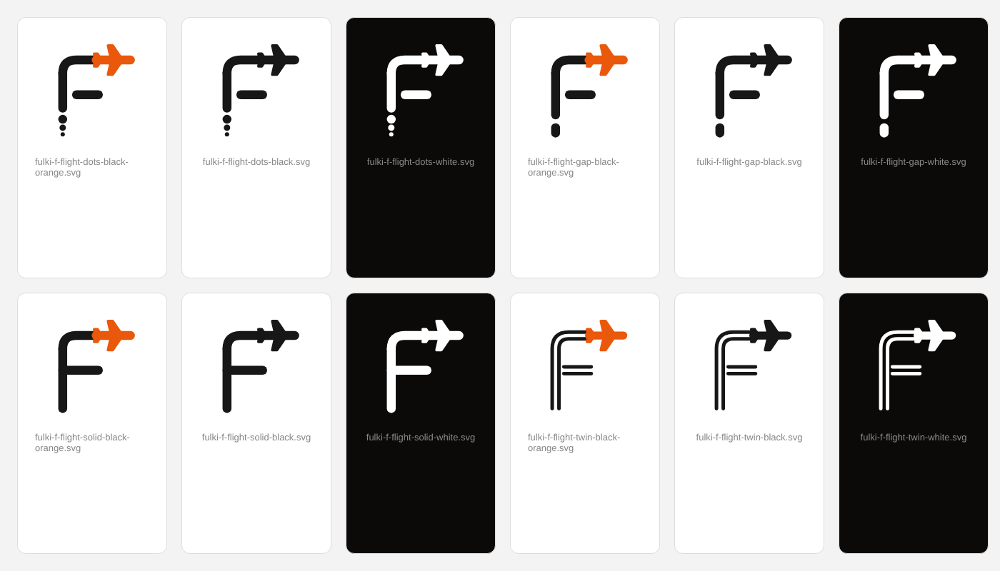

# Fulki Travel & Tours — logo set

Vector masters are the `.svg` files; `png/` holds transparent exports (lockups 2000 px wide, icons 1024 px).
Text is outlined from Outfit, the site's display font, so the files need no fonts installed.

| File | Use |
| --- | --- |
| `fulki-travel-tours-primary.svg` | Default logo on white / light backgrounds |
| `fulki-travel-tours-reversed.svg` | On dark backgrounds and photos |
| `fulki-travel-tours-on-orange.svg` | All-white on brand orange (signage, banners) |
| `fulki-travel-tours-mono-black.svg` | Single-colour print, stamps, fax, engraving |
| `fulki-travel-tours-horizontal.svg` | Website header, email signature, letterhead |
| `fulki-travel-tours-horizontal-reversed.svg` | Same, on dark |
| `fulki-icon-orange.svg` | Icon only: app icon, social avatars |
| `fulki-icon-dark.svg` / `fulki-icon-light.svg` | Icon only on dark / light surfaces |
| `fulki-icon-round.svg` | Icon only, circular crop (WhatsApp, Instagram, Facebook) |
| `fulki-icon-plane.svg` | Alternative icon: plane climbing out of its contrail |

### F icons

The F is the contrail of a plane that climbed the stem and is still flying at the end of the top arm.

**`f-sky/`: sky tiles** (square app icon and round social avatar). Near the plane the trail is two crisp
engine contrails that spread into one soft trail lower down.
Skies: `day`, `day-clouds`, `day-orange-plane`, `sunset` (brand orange), `dusk`.

**`f-flight/`: flat monoline F, transparent background.** Styles: `solid`, `gap` (trail breaking up),
`dots` (trail starting as dots), `twin` (two engine contrails). Each comes in `black`,
`black-orange` (orange plane) and `white`.

Colours: orange `#EA580C`, ink `#171717`, night `#0C0A09`.
Keep clear space around the logo at least the height of the plane, and don't use the
full lockup below 120 px wide; switch to an icon instead.

Regenerate with `python3 tools/build_logos.py` (needs `pip install fonttools brotli uharfbuzz`).
